# SACIP Console: Tài liệu tổng quan kiến trúc và chức năng

| Mục | Nội dung |
|---|---|
| Hệ thống | SACIP Console: bảng điều khiển quản lý định danh khuôn mặt (Face ID) của Trường Đại học Đại Nam |
| Loại tài liệu | Tài liệu phân tích nghiệp vụ (BA): tổng quan kiến trúc, chức năng, luồng hoạt động |
| Người đọc | Ban lãnh đạo nhà trường, trưởng các phòng ban liên quan, nhóm triển khai |
| Phiên bản | 1.0, ngày 09/11/2026 |
| Hiện trạng hệ thống | Bản mẫu chạy được (prototype). Giao diện và quy trình đã hoàn chỉnh; dữ liệu phần lớn là giả lập. Chi tiết ở mục 12 |

---

## Mục lục

1. [Tóm tắt cho lãnh đạo](#1-tóm-tắt-cho-lãnh-đạo)
2. [Thống kê tổng quan](#2-thống-kê-tổng-quan)
3. [Bối cảnh, mục tiêu và phạm vi](#3-bối-cảnh-mục-tiêu-và-phạm-vi)
4. [Người dùng và phân quyền](#4-người-dùng-và-phân-quyền)
5. [Kiến trúc tổng thể](#5-kiến-trúc-tổng-thể)
6. [Mô hình dữ liệu nghiệp vụ](#6-mô-hình-dữ-liệu-nghiệp-vụ)
7. [Bản đồ chức năng](#7-bản-đồ-chức-năng)
8. [Chi tiết từng chức năng](#8-chi-tiết-từng-chức-năng)
9. [Mối liên hệ giữa các chức năng](#9-mối-liên-hệ-giữa-các-chức-năng)
10. [Các luồng nghiệp vụ chính](#10-các-luồng-nghiệp-vụ-chính)
11. [Tuân thủ pháp lý và bảo vệ dữ liệu](#11-tuân-thủ-pháp-lý-và-bảo-vệ-dữ-liệu)
12. [Hiện trạng triển khai, rủi ro và vấn đề mở](#12-hiện-trạng-triển-khai-rủi-ro-và-vấn-đề-mở)
13. [Lộ trình đề xuất](#13-lộ-trình-đề-xuất)
14. [Phụ lục](#14-phụ-lục)

> Các sơ đồ trong tài liệu viết bằng Mermaid. Xem đúng hình khi mở bằng GitHub, GitLab hoặc VS Code (bật xem trước Markdown).

---

## 1. Tóm tắt cho lãnh đạo

**SACIP là gì.** SACIP là hệ thống dùng nhận diện khuôn mặt để thay thẻ và điểm danh thủ công trong trường: ra vào cổng, KTX, phòng thí nghiệm; điểm danh theo tiết học; phát hiện người không có quyền vào khu vực hạn chế. **SACIP Console** là phần mềm quản trị dành cho cán bộ nhà trường, nơi quản lý hồ sơ khuôn mặt, duyệt yêu cầu, cấu hình chính sách, xử lý sự cố và chứng minh việc tuân thủ pháp luật.

**Vì sao cần.** Dữ liệu khuôn mặt là dữ liệu cá nhân nhạy cảm theo Luật Bảo vệ dữ liệu cá nhân (Luật 91/2025). Nhà trường chỉ được xử lý khi người dùng đồng ý, đúng mục đích đã công bố, lưu trong thời hạn cho phép, và phải chứng minh được điều đó khi bị thanh tra. Console được thiết kế để mọi thao tác đều đi qua các chốt kiểm soát này.

**Năm nguyên tắc thiết kế chính:**

1. **Không đồng ý thì không xử lý.** Hồ sơ chưa có đồng ý hợp lệ bị khóa mọi thao tác sinh trắc (xem ảnh, chụp lại, kích hoạt).
2. **Có người chịu trách nhiệm.** AI chỉ được tự duyệt khi điểm đạt ngưỡng; AI không bao giờ tự từ chối hay thu hồi. Thao tác rủi ro cao cần hai người khác nhau.
3. **Mọi thao tác đều để lại dấu vết không xóa được.** Nhật ký truy vết dùng chuỗi mã băm; sửa một dòng là phát hiện được.
4. **Cấu hình thay vì viết cứng.** Ngưỡng chất lượng, người duyệt, khu vực, thời gian… đều nằm trong chính sách có phiên bản, đổi được mà không sửa phần mềm.
5. **Tối thiểu hóa dữ liệu.** Khuôn mặt luôn làm mờ; ảnh gốc chỉ mở 60 giây; không ghi ở khu riêng tư; không dùng thuộc tính nhân khẩu học.

**Hiện trạng.** Console có **15 màn hình** phủ đủ các quy trình. Màn hình *Hồ sơ định danh* đã đọc được dữ liệu thật từ API của trường; các màn hình còn lại chạy trên dữ liệu giả lập mô phỏng đúng hành vi máy chủ. Bước tiếp theo là xây dựng máy chủ thật (backend), đăng nhập thật và nối các hệ thống nguồn (mục 13).

**Các quyết định cần lãnh đạo cho ý kiến** (chi tiết ở mục 12.4):

- Ban hành **điều khoản đồng ý v1.3** và **DPIA cập nhật** để mở các mục đích mới (an ninh khu hạn chế, theo dõi trong tiết, nhận diện giảng viên, ghi lượt ra vào).
- Thống nhất **thời hạn xóa mẫu khuôn mặt** sau khi rút đồng ý (hiện tài liệu ghi 20 ngày, điều khoản và chính sách ghi 30 ngày).
- Với giảng viên, cán bộ: đưa việc dùng Face ID vào **nội quy lao động** và lấy ý kiến công đoàn.

---

## 2. Thống kê tổng quan

### 2.1. Quy mô chức năng

| Hạng mục | Số lượng | Ghi chú |
|---|---:|---|
| Màn hình (route) | 15 | 14 màn hình chính + 1 trình sửa chính sách |
| Nhóm menu | 3 | Vận hành (4), Cấu hình (6), Giám sát (4) |
| Vai trò người dùng | 4 | Quản trị, Kiểm toán viên trưởng, Cán bộ Phòng Đào tạo, Trực an ninh |
| Loại đối tượng | 5 | Sinh viên, Cán bộ/giảng viên, Nhà thầu, Cư dân KTX, Khách |
| Chiều trạng thái của một hồ sơ | 5 | Đồng ý, Thu thập, Hiệu lực, Yêu cầu, Rủi ro |
| Loại yêu cầu | 5 | Đăng ký mới, Chụp lại, Gia hạn, Khóa/thu hồi, Rút đồng ý |
| Chính sách sinh trắc | 5 | Mỗi loại đối tượng một chính sách, có lịch sử phiên bản |
| Quy tắc sự kiện | 14 | 7 đang chạy, 3 chạy bóng, 4 tắt (chờ căn cứ pháp lý) |
| Chính sách nhận cảnh báo | 7 | An ninh, học vụ, KTX, vận hành |
| Mục đích xử lý dữ liệu | 8 | 3 đã có căn cứ, 5 đang chờ điều khoản v1.3 |
| Hệ thống nguồn dữ liệu | 6 | Đào tạo, Nhân sự, Nhà thầu, KTX, Chấm công, Danh mục không gian |
| Loại sự kiện gửi ra ngoài | 7 | Đào tạo, Kiểm soát ra vào, Thông báo (5 loại) |
| Mã hành động trong nhật ký | 48 | Mỗi thao tác có một mã riêng để lọc |
| Mã nguồn | ~7.450 dòng | React 18, Vite 5, Tailwind CSS 3 |

### 2.2. Số liệu nghiệp vụ trong dữ liệu mẫu

Số liệu dưới đây là dữ liệu giả lập dùng để trình diễn, đã được cân đối để khớp nhau giữa các màn hình.

| Chỉ số | Giá trị |
|---|---:|
| Tổng số người thuộc phạm vi | 24.850 |
| &nbsp;&nbsp;Sinh viên | 21.480 |
| &nbsp;&nbsp;Cán bộ, giảng viên | 1.620 |
| &nbsp;&nbsp;Cư dân KTX | 1.200 |
| &nbsp;&nbsp;Khách | 336 |
| &nbsp;&nbsp;Nhân viên nhà thầu | 214 |
| Đã thu thập Face ID | 23.302 (93,8%) |
| Đã đồng ý (mọi phiên bản điều khoản) | 23.874 (96,1%) |
| Đồng ý theo điều khoản hiện hành v1.2 | 19.840 (79,8%) |
| Còn ở điều khoản cũ v1.0, v1.1 | 4.034 |
| Chưa xác nhận đồng ý | 846 |
| Đã rút đồng ý | 130 |
| Tỷ lệ AI tự duyệt (7 ngày) | 78,4% (1.402 tự duyệt / 386 người duyệt) |
| Hạ tầng mẫu | 3 tòa nhà, 11 phòng/khu vực, 15 thiết bị |

---

## 3. Bối cảnh, mục tiêu và phạm vi

### 3.1. Bài toán

| Vấn đề hiện tại | Hệ quả |
|---|---|
| Điểm danh thủ công, thẻ dễ mượn | Tốn thời gian tiết học, khó phát hiện học hộ |
| Ra vào khu vực hạn chế (phòng Server, phòng thí nghiệm) dựa vào thẻ | Không biết chắc ai thực sự vào |
| Mỗi đơn vị (Đào tạo, KTX, HCQT, nhà thầu) quản lý danh sách riêng | Dữ liệu lệch nhau, khó thu hồi quyền kịp thời khi hết hợp đồng, thôi học |
| Dữ liệu khuôn mặt là dữ liệu nhạy cảm | Rủi ro pháp lý cao nếu không chứng minh được đồng ý, mục đích, thời hạn lưu |

### 3.2. Mục tiêu của Console

1. **Một nơi quản lý tập trung** hồ sơ Face ID của mọi loại đối tượng.
2. **Quy trình duyệt minh bạch**, đúng người đúng bước, có hạn xử lý.
3. **Cấu hình linh hoạt** theo từng loại đối tượng mà không phải sửa phần mềm.
4. **Phát hiện và xử lý sự cố** an ninh nhanh (mục tiêu phát cảnh báo dưới 2 giây).
5. **Tuân thủ và chứng minh tuân thủ** Luật Bảo vệ dữ liệu cá nhân.
6. **Kết nối hai chiều** với các hệ thống sẵn có của trường.

### 3.3. Phạm vi

| Trong phạm vi Console | Ngoài phạm vi Console (hệ thống khác đảm nhận) |
|---|---|
| Quản lý hồ sơ, trạng thái, yêu cầu, phê duyệt | Chụp ảnh khuôn mặt: App MyDaiNam và trạm chụp tại quầy |
| Cấu hình chính sách, quy tắc, cảnh báo | Nhận diện thời gian thực tại camera, cổng: thiết bị xử lý biên |
| Quản lý không gian, thiết bị, quyền ra vào | Mở cổng, cửa từ: hệ thống kiểm soát ra vào (ACS) |
| Theo dõi đồng ý, mục đích, thời hạn lưu, xóa dữ liệu | Gửi thông báo đến người dùng: hệ thống thông báo |
| Xử lý sự cố an ninh, ngoại lệ học vụ | Lưu kết quả học tập: Hệ thống Đào tạo |
| Giám sát chất lượng AI, nhật ký truy vết | Người dùng cuối ký đồng ý, gửi yêu cầu: App MyDaiNam |

---

## 4. Người dùng và phân quyền

### 4.1. Vai trò

| Vai trò | Ai | Công việc chính |
|---|---|---|
| Quản trị hệ thống | Phòng CNTT | Cấu hình chính sách, không gian, thiết bị, đơn vị; được ký mọi bước duyệt |
| Kiểm toán viên trưởng | Cán bộ bảo vệ dữ liệu, kiểm toán nội bộ | Xem nhật ký truy vết, duyệt rút đồng ý, duyệt tra cứu hành trình, giám sát AI |
| Cán bộ Phòng Đào tạo | Phòng Đào tạo (vai trò mặc định) | Quản lý hồ sơ, duyệt yêu cầu, xử lý ngoại lệ điểm danh, theo dõi đồng ý |
| Trực an ninh | Đội bảo vệ, an ninh | Xử lý sự cố an ninh, khóa hồ sơ, gửi yêu cầu tra cứu hành trình |

### 4.2. Ma trận quyền xem màn hình

| Màn hình | Quản trị | Kiểm toán viên | Phòng Đào tạo | Trực an ninh |
|---|:-:|:-:|:-:|:-:|
| Tổng quan, Hồ sơ, Hộp yêu cầu | ✓ | ✓ | ✓ | ✓ |
| Bảo vệ dữ liệu cá nhân | ✓ | ✓ | ✓ | |
| Chính sách, Đơn vị, Không gian, Thiết bị, Tích hợp, Lịch học | ✓ | ✓ | ✓ | ✓ |
| Sự cố an ninh | ✓ | | | ✓ |
| Lượt ra vào khu vực | ✓ | ✓ | | ✓ |
| Giám sát AI | ✓ | ✓ | ✓ | ✓ |
| Nhật ký truy vết | ✓ | ✓ | | |

### 4.3. Ai được duyệt bước nào

Chuỗi duyệt lấy từ chính sách của từng loại đối tượng. Bước của đơn vị ngoài Console (GVCN, Trưởng đơn vị…) do vai trò tương ứng ghi nhận thay. Quản trị được ký mọi bước.

| Bước trong chuỗi duyệt | Vai trò được xác nhận |
|---|---|
| GVCN / Cố vấn học tập, Phòng Đào tạo, Trưởng đơn vị, Ban Quản lý KTX, Đơn vị bảo lãnh | Cán bộ Phòng Đào tạo |
| Đơn vị quản lý hợp đồng, Phòng Hành chính - Quản trị | Trực an ninh |
| Cán bộ bảo vệ dữ liệu (rút đồng ý) | Kiểm toán viên trưởng |

**Nguyên tắc hai người (4 mắt):** thu hồi Face ID và tra cứu hành trình một người đều cần hai cán bộ **khác nhau**; hệ thống chặn một người tự xác nhận hai lần.

---

## 5. Kiến trúc tổng thể

### 5.1. Sơ đồ ngữ cảnh hệ thống

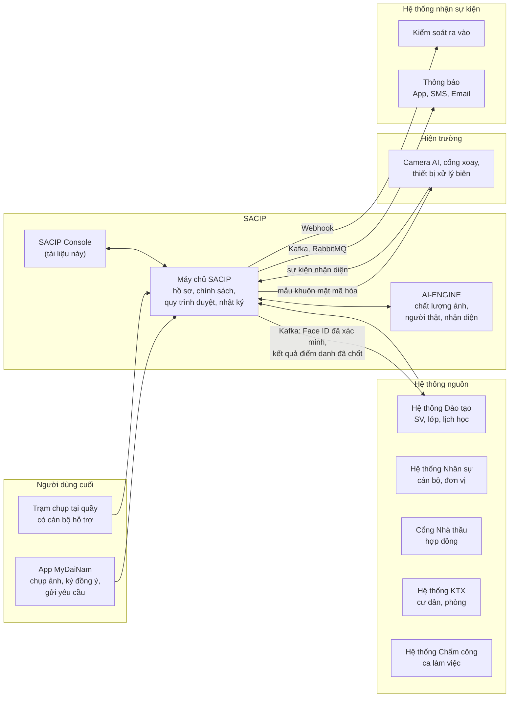

### 5.2. Kiến trúc logic của Console

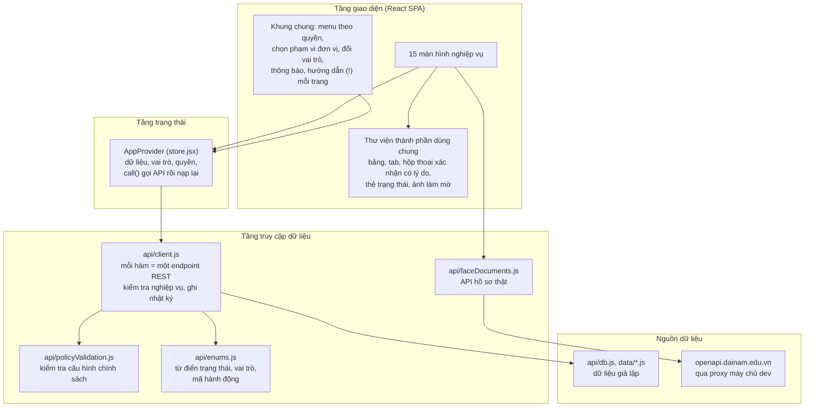

**Điểm thiết kế quan trọng:** toàn bộ nghiệp vụ nằm trong `api/client.js`, mỗi hàm tương ứng đúng một endpoint REST (ghi ở chú thích đầu hàm). Khi có máy chủ thật, chỉ cần thay thân hàm bằng lệnh gọi mạng, giữ nguyên tên hàm và dạng dữ liệu trả về; các màn hình không phải sửa.

### 5.3. Công nghệ

| Thành phần | Công nghệ | Vai trò |
|---|---|---|
| Khung giao diện | React 18.3 | Xây màn hình theo thành phần |
| Điều hướng | React Router 6 (HashRouter) | Đường dẫn dạng `#/ho-so`, chạy được cả khi mở file tĩnh |
| Đóng gói | Vite 5 | Chạy thử, đóng gói; có chế độ xuất 1 file HTML duy nhất |
| Giao diện | Tailwind CSS 3, Material Symbols, phông IBM Plex | Hệ thống thiết kế thống nhất |
| Dữ liệu thật | Proxy của máy chủ Vite | Giữ khóa API ở máy chủ, không lộ ra trình duyệt |

### 5.4. Khung giao diện chung

Mọi màn hình chia sẻ:

- **Menu trái** chia 3 nhóm, ẩn mục người dùng không có quyền; có huy hiệu số yêu cầu chờ duyệt, chấm đỏ khi nguồn dữ liệu lỗi hoặc có sự cố nghiêm trọng chưa tiếp nhận.
- **Thanh trên** chọn phạm vi (cơ sở, đơn vị, loại đối tượng), đổi vai trò mô phỏng đăng nhập, xem thông báo.
- **Nút (!) cạnh tiêu đề** mở hướng dẫn nhanh: trang dùng làm gì, ai dùng, cách dùng.
- **Hộp thoại xác nhận có lý do** cho mọi thao tác nhạy cảm; lý do được ghi vào nhật ký.

---

## 6. Mô hình dữ liệu nghiệp vụ

### 6.1. Sơ đồ quan hệ thực thể

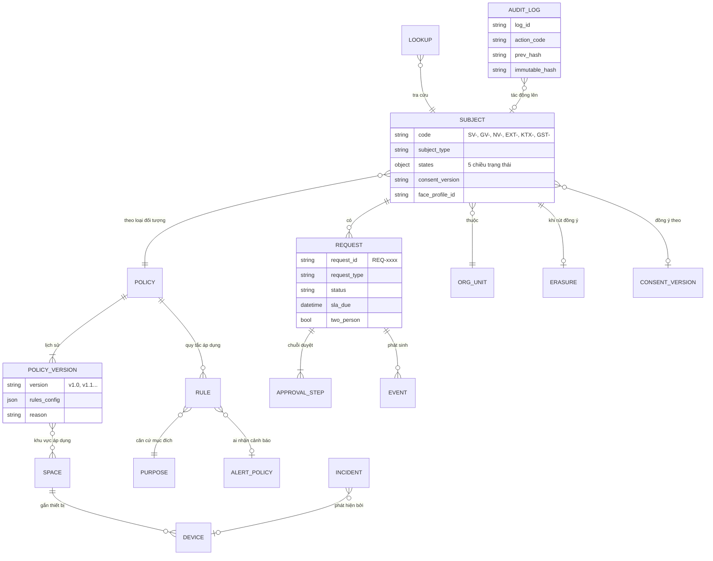

### 6.2. Năm chiều trạng thái của một hồ sơ

Hệ thống **không gộp** trạng thái thành một cột, vì mỗi chiều do một quy trình khác quản lý.

| Chiều | Giá trị | Quy trình quyết định |
|---|---|---|
| Đồng ý | Đã xác nhận (kèm phiên bản) · Chờ xác nhận · Đã rút | Người dùng trên App; Console chỉ theo dõi |
| Thu thập | Chưa thu thập · Đang thu thập · Đã thu thập · Lỗi chất lượng | App / trạm quầy + AI kiểm tra chất lượng |
| Hiệu lực | Chưa có · Chờ kích hoạt · Đang hiệu lực · Sắp hết hạn · Đã khóa · Đã thu hồi | Hộp yêu cầu, thao tác khóa/mở khóa |
| Yêu cầu | Không có · Đang chờ duyệt · Được chụp lại | Tự suy ra từ Hộp yêu cầu |
| Rủi ro | Không có · Cần theo dõi · Rủi ro cao | AI gắn cờ hoặc cán bộ gắn cờ; chỉ Trực an ninh gỡ |

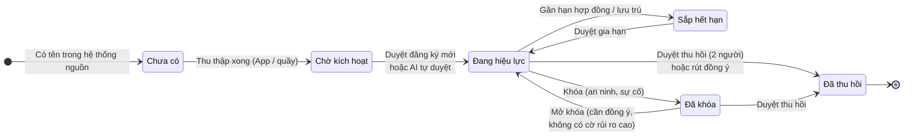

Mỗi lần hiệu lực đổi, hệ thống gửi ngay sự kiện tới **Kiểm soát ra vào**: còn hiệu lực thì gửi mẫu khuôn mặt đã mã hóa (AES-256), hết hiệu lực thì gửi lệnh xóa mẫu khỏi thiết bị.

---

## 7. Bản đồ chức năng

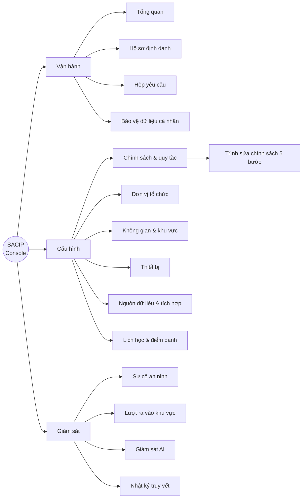

| # | Màn hình | Đường dẫn | Nhóm | Người dùng chính |
|---:|---|---|---|---|
| 1 | Tổng quan | `#/` | Vận hành | Mọi cán bộ |
| 2 | Hồ sơ định danh | `#/ho-so` | Vận hành | Phòng Đào tạo |
| 3 | Hộp yêu cầu | `#/yeu-cau` | Vận hành | Người duyệt các bước |
| 4 | Bảo vệ dữ liệu cá nhân | `#/dong-y` | Vận hành | Cán bộ bảo vệ dữ liệu |
| 5 | Chính sách & quy tắc | `#/chinh-sach` | Cấu hình | Quản trị |
| 6 | Trình sửa chính sách | `#/chinh-sach/:id/sua` | Cấu hình | Quản trị |
| 7 | Đơn vị tổ chức | `#/don-vi` | Cấu hình | Quản trị |
| 8 | Không gian & khu vực | `#/khong-gian` | Cấu hình | HCQT, Quản trị |
| 9 | Thiết bị | `#/thiet-bi` | Cấu hình | Kỹ thuật |
| 10 | Nguồn dữ liệu & tích hợp | `#/tich-hop` | Cấu hình | Kỹ thuật |
| 11 | Lịch học & điểm danh | `#/thoi-khoa-bieu` | Cấu hình | Phòng Đào tạo |
| 12 | Sự cố an ninh | `#/soc` | Giám sát | Trực an ninh |
| 13 | Lượt ra vào khu vực | `#/di-lai` | Giám sát | An ninh, Kiểm toán |
| 14 | Giám sát AI | `#/giam-sat-ai` | Giám sát | Kỹ thuật, Kiểm toán |
| 15 | Nhật ký truy vết | `#/nhat-ky` | Giám sát | Kiểm toán viên |

---

## 8. Chi tiết từng chức năng

Mỗi chức năng trình bày theo cùng khung: **mục đích khởi tạo**, **người dùng**, **thành phần chính**, **quy tắc nghiệp vụ**, **liên kết với chức năng khác**.

### 8.1. Tổng quan

**Mục đích khởi tạo.** Lãnh đạo và cán bộ cần biết trong 30 giây: Face ID đã phủ được bao nhiêu, ở đâu đang chậm, và hôm nay có việc gì gấp. Không phải mở từng màn hình để tổng hợp.

**Người dùng.** Mọi cán bộ; lãnh đạo dùng để theo dõi tiến độ.

**Thành phần chính:**

| Khối | Nội dung | Bấm vào thì đi đâu |
|---|---|---|
| 4 chỉ số đầu trang | Tỷ lệ phủ Face ID; đồng ý điều khoản v1.2; yêu cầu chụp lại chờ duyệt; AI tự duyệt 7 ngày | Hồ sơ (nhóm Chưa thu thập); Bảo vệ dữ liệu; Hộp yêu cầu (lọc Chụp lại); Giám sát AI |
| Bảng tỷ lệ phủ | Theo khoa (mở rộng theo khóa), theo khóa, cán bộ, nhà thầu, KTX, khách; xếp từ thấp đến cao, dưới 90% tô vàng | |
| Cảnh báo bất thường | Lệch chuẩn AI và nghi giả mạo đang mở | Giám sát AI; Sự cố an ninh |
| Hàng chờ | Tất cả chờ duyệt, đăng ký mới, rút đồng ý, chờ xóa dữ liệu | Hộp yêu cầu (lọc sẵn); Bảo vệ dữ liệu |
| Cần xử lý | Sự cố nghiêm trọng, cảnh báo lệch chuẩn cao, ngoại lệ học vụ, yêu cầu sắp quá hạn, nguồn dữ liệu lỗi, thiết bị mất kết nối | Đúng màn hình xử lý của từng mục |

**Quy tắc nghiệp vụ.**

- Mọi con số hàng chờ đếm trực tiếp từ Hộp yêu cầu, nên bấm vào luôn thấy đúng số đó.
- Tổng các nhóm trong bảng phủ bằng đúng tổng trong thống kê đồng ý (24.850).
- Mục nào người dùng không có quyền mở thì vẫn hiện để biết, nhưng không bấm được.
- Đổi đơn vị ở thanh trên cùng thì bảng theo khoa chỉ còn đơn vị đó.

### 8.2. Hồ sơ định danh

**Mục đích khởi tạo.** Thay cho nhiều danh sách rời rạc ở từng phòng ban bằng **một bảng duy nhất** cho mọi loại đối tượng, thể hiện đủ 5 chiều trạng thái để cán bộ biết chính xác vì sao một người chưa dùng được Face ID.

**Người dùng.** Phòng Đào tạo (thao tác), các vai trò khác (xem).

**Thành phần chính:**

- **Tab nhóm nhanh:** Tất cả, Chưa thu thập, Chưa có đồng ý, Có cờ rủi ro, Có yêu cầu mở, Sắp hết hạn.
- **Bộ lọc:** loại đối tượng, nguồn ảnh (App, ảnh thẻ, tại quầy), hiệu lực, đồng ý; tìm theo mã, tên, email.
- **Thao tác hàng loạt:** yêu cầu chụp lại, kích hoạt, nhắc thu thập, khóa. Hồ sơ không đủ điều kiện bị bỏ qua và báo rõ lý do, không làm hỏng cả lô.
- **Ngăn chi tiết hồ sơ:**
  - Lưới 5 trạng thái, ảnh các tư thế (làm mờ) và điểm chất lượng từng ảnh.
  - Xem ảnh gốc: phải nhập lý do, mở qua đường dẫn có chữ ký sống 60 giây, tự làm mờ lại.
  - Gắn / gỡ cờ rủi ro (gỡ chỉ Trực an ninh).
  - Tra soát khiếu nại "vì sao không nhận diện được": Wi-Fi, beacon gần nhất.
  - Danh sách yêu cầu liên quan, mở thẳng sang Hộp yêu cầu.
  - Khóa, mở khóa, kích hoạt, thu hồi, tạo yêu cầu chụp lại.
  - Gửi yêu cầu xác nhận điều khoản cho người chưa đồng ý hoặc còn ở điều khoản cũ.

**Quy tắc nghiệp vụ.**

- Chưa có đồng ý hợp lệ: khóa xem ảnh, chụp lại, kích hoạt, mở khóa.
- Hồ sơ đang có yêu cầu đăng ký mới chờ duyệt thì **không kích hoạt trực tiếp được**; nút chuyển thành "Duyệt REQ-xxxx" để đi đúng chuỗi duyệt.
- Có cờ rủi ro cao thì không mở khóa, không kích hoạt cho đến khi gỡ cờ.
- Thu hồi không làm ngay mà tạo yêu cầu vào Hộp yêu cầu.
- Mọi thao tác ghi Nhật ký truy vết; khóa / mở khóa / kích hoạt gửi ngay sự kiện tới Kiểm soát ra vào.

**Chế độ dữ liệu thật.** Khi bật `VITE_PROFILES_LIVE=1`, màn hình đọc hồ sơ xác thực khuôn mặt từ API của trường (`business-documents/search`), chỉ xem, nhóm theo trạng thái của tài liệu (Chờ duyệt, Đã duyệt, Đã từ chối, Đã gửi lại, Đã xác minh).

### 8.3. Hộp yêu cầu

**Mục đích khởi tạo.** Gom mọi yêu cầu liên quan Face ID vào **một hàng đợi** có hạn xử lý, chuỗi duyệt lấy từ chính sách, để không yêu cầu nào bị bỏ sót hay duyệt sai người.

**Người dùng.** Người duyệt từng bước (mục 4.3).

**Năm loại yêu cầu và kết quả khi duyệt xong:**

| Loại | Nguồn gửi | Khi được duyệt |
|---|---|---|
| Đăng ký mới | App, quầy | Kích hoạt Face ID; báo Hệ thống Đào tạo "đã xác minh" (sinh viên); gửi mẫu xuống thiết bị |
| Chụp lại | App, Console | Mở quyền chụp lại qua kênh chính sách cho phép (App / tại quầy), có thời hạn và số lần; báo người gửi |
| Gia hạn | App | Gia hạn hiệu lực, cập nhật thiết bị |
| Khóa, thu hồi | Console | Thu hồi quyền ở mọi cổng và camera ngay |
| Rút đồng ý | App | Khóa mọi thiết bị, mở phiếu xóa dữ liệu theo thời hạn của chính sách |

**Thành phần chính:** tab trạng thái (Chờ duyệt, Đã từ chối, Đã hoàn thành, Đã hủy, Tất cả); lọc theo loại; chi tiết gồm lý do người gửi, kết quả AI (chất lượng, khớp CCCD, người thật), chuỗi phê duyệt dạng dòng thời gian, sự kiện đã gửi sang hệ thống khác.

**Quy tắc nghiệp vụ.**

- Mỗi bước chỉ vai trò được giao mới duyệt hoặc từ chối được; nút bị khóa ghi rõ ai được duyệt.
- Từ chối bắt buộc nêu lý do (tối thiểu 10 ký tự); lý do lưu công khai và gửi về App.
- **Không được từ chối yêu cầu rút đồng ý** (quyền của chủ thể dữ liệu).
- Thu hồi cần 2 cán bộ khác nhau xác nhận ở bước cuối.
- AI chỉ tự duyệt khi chính sách bật và điểm tin cậy đạt ngưỡng; được ghi nhật ký riêng.
- Người gửi tự hủy trên App thì yêu cầu chuyển "Đã hủy"; hủy rút đồng ý thì giữ lại đồng ý cũ và bỏ phiếu xóa chưa bắt đầu.
- Trạng thái "Yêu cầu" của hồ sơ luôn suy ra từ hàng đợi, nên đóng một yêu cầu không làm mất yêu cầu khác của cùng người.

### 8.4. Bảo vệ dữ liệu cá nhân

**Mục đích khởi tạo.** Chứng minh nhà trường xử lý dữ liệu khuôn mặt đúng luật: có đồng ý, đúng mục đích, đúng thời hạn, và xóa khi người dùng yêu cầu.

**Người dùng.** Cán bộ bảo vệ dữ liệu, Kiểm toán viên, Phòng Đào tạo.

**Ba tab:**

| Tab | Nội dung | Thao tác |
|---|---|---|
| Trạng thái đồng ý | 5 chỉ số, thanh phân bố (v1.2 / điều khoản cũ / chưa xác nhận / đã rút), lịch sử 3 phiên bản điều khoản, khung **Quyền được lãng quên** (4 bước: khóa thiết bị → xóa ảnh gốc → xóa mẫu sinh trắc → gửi biên bản), danh sách người cần xử lý | Mời xác nhận v1.2; nhắc người chưa xác nhận; thực hiện bước xóa tiếp theo; mở hồ sơ |
| Mục đích xử lý | 8 mục đích, căn cứ pháp lý, số người đã đồng ý, quy tắc nào đang dùng | Xem |
| Lưu trữ & DPIA | Trạng thái hồ sơ đánh giá tác động (DPIA), thời hạn lưu từng loại dữ liệu | Xem |

**Quy tắc nghiệp vụ.**

- Đồng ý cũ chỉ dùng được cho mục đích cũ; mục đích mới (phát hành thẻ) cần đồng ý v1.2.
- Quy tắc sự kiện chỉ được bật thật khi mục đích của nó đã có căn cứ.
- Phiếu xóa có hạn; quá hạn hiện đỏ.
- Thống kê luôn giữ đúng tổng khi có người đồng ý mới, rút đồng ý hoặc hủy rút.

### 8.5. Chính sách & quy tắc

**Mục đích khởi tạo.** Mỗi loại đối tượng cần cách vận hành khác nhau (sinh viên chụp qua App, nhà thầu phải ra quầy; cán bộ duyệt bởi trưởng đơn vị, nhà thầu bởi đơn vị quản lý hợp đồng…). Đặt hết vào **chính sách có phiên bản** để thay đổi nhanh, có lý do, có thể khôi phục, không phải sửa phần mềm.

**Ba tab:**

1. **Chính sách sinh trắc** (5 chính sách: POL-STU, POL-STF, POL-CTR, POL-RES, POL-GST): xem cấu hình hiện hành, lịch sử phiên bản, khôi phục phiên bản cũ.
2. **Quy tắc sự kiện** (14 quy tắc R-001 đến R-013, gồm R-004A và R-004B): mỗi quy tắc gắn một mục đích xử lý và một chính sách cảnh báo; có 3 chế độ **Đang chạy / Chạy bóng / Tắt**. Tạo từ mẫu, chạy bóng để so sánh, bật thật cần người thứ hai duyệt.
3. **Nhận cảnh báo** (7 chính sách AP-…): ai nhận, kênh nào, gộp ra sao, leo thang khi chưa ai tiếp nhận.

**Trình sửa chính sách 5 bước:**

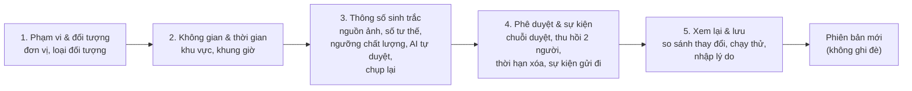

**Quy tắc nghiệp vụ.**

- Mỗi loại đối tượng chỉ thuộc **một** chính sách.
- Nguồn ảnh phải hợp với loại đối tượng (nhà thầu, khách không có App).
- Kênh chụp lại phải thuộc nguồn được chấp nhận.
- Ngưỡng AI tự duyệt không thấp hơn ngưỡng chất lượng ảnh.
- **Chạy thử** ước tính ảnh hưởng trên dữ liệu 24 giờ qua: số người, số thiết bị, thiết bị mất kết nối, số yêu cầu sẽ được AI tự duyệt trước và sau, xung đột với chính sách khác.
- Lưu bắt buộc nhập lý do; mỗi lần lưu là một phiên bản mới.

**Cấu hình hiện hành của 5 chính sách:**

| Chính sách | Nguồn ảnh | Tư thế | Ngưỡng chất lượng | AI tự duyệt | Chụp lại | Chuỗi duyệt | Xóa sau rút đồng ý |
|---|---|---:|---:|---|---|---|---:|
| POL-STU Sinh viên (v1.3) | App, ảnh thẻ, quầy | 6 | 85 | Bật, ≥ 95% | App, 48 giờ | GVCN → Phòng Đào tạo | 30 ngày |
| POL-STF Cán bộ, GV (v1.1) | Ảnh thẻ, quầy, App | 6 | 85 | Tắt | App, quầy, 72 giờ | Trưởng đơn vị | 30 ngày |
| POL-CTR Nhà thầu (v1.0) | Quầy | 6 | 88 | Tắt | Quầy, 24 giờ | Đơn vị quản lý HĐ → HCQT | 7 ngày |
| POL-RES Cư dân KTX (v1.0) | App, ảnh thẻ, quầy | 6 | 85 | Bật, ≥ 96% | App, quầy, 48 giờ | Ban Quản lý KTX | 30 ngày |
| POL-GST Khách (v1.0) | Quầy | 3 | 80 | Tắt | Quầy, 4 giờ | Đơn vị bảo lãnh | 1 ngày |

### 8.6. Đơn vị tổ chức

**Mục đích khởi tạo.** Chính sách và số liệu cần khoanh theo đơn vị. Cây đơn vị lấy từ nguồn để không phải nhập tay hai lần.

**Nội dung.** Cây Toàn trường → Khoa/Viện (6), Phòng ban (3), Ban Quản lý KTX, Đơn vị thuê ngoài (2). Đơn vị đến từ Hệ thống Nhân sự hoặc Cổng Nhà thầu chỉ xem; Console chỉ khai báo nhóm và đơn vị chưa có trong nguồn. Không cho ngừng dùng đơn vị còn hồ sơ hoặc chính sách gắn vào.

### 8.7. Không gian & khu vực

**Mục đích khởi tạo.** Quyền ra vào và vị trí camera gắn với phòng cụ thể. Cần một sơ đồ chuẩn và quy trình duyệt hạ tầng trước khi thiết bị bắt đầu thu dữ liệu.

**Nội dung.**

- Cây Tòa → Tầng → Phòng (mẫu: 3 tòa, 11 phòng).
- Loại khu vực: Công cộng, Vận hành, Hạn chế, Cấm.
- Phòng mới phải **duyệt hạ tầng** rồi mới gán thiết bị và chọn được trong chính sách.
- Công tắc **"Ghi lượt ra vào khi qua zone này"** cho từng phòng; khu riêng tư (nhà vệ sinh, y tế, tư vấn tâm lý, phòng ở KTX…) không bao giờ được bật.
- Tab **Quyền ra vào**: cấp hoặc từ chối quyền cho nhóm người; quy tắc "từ chối thắng cho phép".

### 8.8. Thiết bị

**Mục đích khởi tạo.** Biết thiết bị nào đang ở đâu, còn hoạt động không, để không có "điểm mù" ở cổng và lớp học.

**Nội dung.** Danh sách camera AI, cổng xoay, đầu ghi, trạm chụp, Wi-Fi, beacon (mẫu: 15 thiết bị) với IP, MAC, cổng mạng, số seri, phòng, trạng thái trực tuyến, đồng bộ giờ. Lọc mất kết nối, chưa gán phòng. Khai báo thiết bị mới. Chỉ gán được vào phòng đã duyệt hạ tầng. Chỉ thiết bị nhận diện (camera, cổng xoay, thiết bị xử lý biên) mới nhận mẫu khuôn mặt.

### 8.9. Nguồn dữ liệu & tích hợp

**Mục đích khởi tạo.** SACIP **không tự tạo người, phòng hay đơn vị**; mọi thứ đến từ hệ thống nguồn. Ngược lại, mọi thay đổi trạng thái phải được báo sang hệ thống khác. Màn hình này cho thấy hai chiều đó có đang thông suốt không.

**Nguồn đầu vào:**

| Nguồn | Cung cấp | Cách đồng bộ |
|---|---|---|
| Hệ thống Đào tạo | Sinh viên, lớp học phần, lịch học | Webhook + đồng bộ đêm |
| Hệ thống Nhân sự | Cán bộ, giảng viên, chức danh | Định kỳ 2 giờ |
| Cổng Quản lý Nhà thầu | Nhân viên nhà thầu, số và hạn hợp đồng | Webhook |
| Hệ thống KTX | Cư dân, tòa, phòng, hạn lưu trú | Đồng bộ đêm |
| Hệ thống Chấm công | Ca làm việc cán bộ, nhà thầu | Định kỳ 1 giờ |
| Danh mục không gian | Tòa, tầng, phòng, cổng | Khai báo trên Console |

**Sự kiện gửi đi:**

| Sự kiện | Khi nào | Gửi tới | Kênh |
|---|---|---|---|
| Báo Đào tạo khi đủ Face ID | Sinh viên thu thập xong (không chờ duyệt hiệu lực) | Hệ thống Đào tạo | Kafka |
| Cập nhật quyền tại cổng | Hiệu lực đổi (kích hoạt, khóa, thu hồi, gia hạn) | Kiểm soát ra vào | Webhook |
| Báo kết quả chụp lại | Yêu cầu chụp lại được duyệt / từ chối | Thông báo | Kafka |
| Báo cờ rủi ro | Hồ sơ bị gắn cờ | An ninh | RabbitMQ |
| Báo hợp đồng sắp hết hạn | Tác vụ quét hằng ngày 06:00 | Thông báo | Webhook |
| Báo kết quả duyệt | Yêu cầu khác bị từ chối | Thông báo | Kafka |
| Mời xác nhận điều khoản | Cán bộ gửi lời mời | Thông báo | Kafka |

Sự kiện gửi thất bại hiện "Đang thử lại" kèm lỗi và có thể gửi lại thủ công.

### 8.10. Lịch học & điểm danh

**Mục đích khởi tạo.** Thay điểm danh tay bằng kết luận tự động **theo từng tiết**, có giảng viên xác nhận và sinh viên khiếu nại được trước khi chốt, đồng thời gom các ngoại lệ học vụ về đúng người xử lý là Phòng Đào tạo.

**Sáu tab:**

| Tab | Nội dung |
|---|---|
| Lịch học | Lịch lấy từ Hệ thống Đào tạo (chỉ đọc); mỗi tiết có số có mặt, muộn, vắng giữa giờ, vắng, có phép, không xác định, trạng thái chốt, trạng thái ghi hình; chi tiết từng sinh viên |
| Ngoại lệ & khiếu nại | Dạy thay chưa đăng ký (duyệt / không duyệt); khiếu nại điểm danh (chấp nhận / giữ nguyên). Chỉ Phòng Đào tạo, Quản trị xử lý |
| Báo cáo hiện diện | Tỷ lệ có mặt theo khoa; sinh viên sắp vượt ngưỡng vắng; ngoại lệ giảng dạy (không xếp hạng GV); xuất Excel; đẩy kết quả đã chốt về Đào tạo |
| Tham số điểm danh | Ân hạn đi muộn, ngưỡng vắng giữa giờ…; mặc định toàn trường, ghi đè theo khoa/học phần |
| Luồng điểm danh | Mô tả 8 bước kỹ thuật cho người dùng hiểu cách hệ thống kết luận |
| Xử lý bài giảng | Tiến độ tải video, tách âm, lọc ồn, tạo phụ đề |

**Quy tắc nghiệp vụ.** "Không xác định" không tính là vắng. Kết luận lúc kết thúc tiết, không cảnh báo tức thời. GV xác nhận trong 48 giờ, SV khiếu nại trong 7 ngày; chỉ kết quả đã chốt và hết hạn khiếu nại mới đẩy về Hệ thống Đào tạo. SACIP không tự cấm thi. Số liệu là chỉ số hiện diện, không dùng làm căn cứ duy nhất để đánh giá hay kỷ luật.

### 8.11. Sự cố an ninh

**Mục đích khởi tạo.** Bàn trực cho đội an ninh: những gì cần người ra hiện trường **ngay**, tách khỏi việc học vụ và việc kỹ thuật.

**Ba nhóm sự cố:**

| Nhóm | Ví dụ | Phát hiện bởi |
|---|---|---|
| Vào sai khu vực | Không có quyền vào phòng Server; trùng danh sách cấm tại cổng | Quy tắc R-003, R-004B |
| Giả mạo, gian lận thiết bị | 14 lượt đăng ký từ cùng một điện thoại; ảnh chụp từ màn hình tại cổng | AI-ENGINE |
| Thiết bị an ninh | Camera sảnh mất kết nối | Giám sát thiết bị |

**Quy trình:** Tiếp nhận → (tùy chọn) Xem minh chứng có lý do → Đóng sự cố kèm mô tả đã xử lý. Mọi bước được lưu và ghi nhật ký. Khuôn mặt luôn làm mờ; minh chứng lưu 30 ngày. Chấm đỏ trên menu khi còn sự cố nghiêm trọng chưa tiếp nhận. Mục tiêu phát cảnh báo dưới 2 giây (hiện đo 1,6 giây).

### 8.12. Lượt ra vào khu vực

**Mục đích khởi tạo.** Giống trạm camera giao thông ghi biển số: khi xảy ra sự cố (mất tài sản, đột nhập) cần biết ai đã đi qua khu vực nào lúc nào. Nhưng đây là dữ liệu vị trí gắn với sinh trắc, rất nhạy cảm, nên **chỉ được tra theo cá nhân khi có sự cố và có người thứ hai duyệt**.

**Hiện trạng:** quy tắc R-013 đang **chạy bóng** (chỉ lưu số đếm ẩn danh) vì mục đích này chưa có trong điều khoản hiện hành.

**Bốn tab:** Luồng ghi nhận (danh tính luôn che); Tra cứu hành trình một người; Lưu lượng theo zone (ẩn danh, ai cũng xem được); Lịch sử tra cứu.

**Quy trình tra cứu:**

- Gửi yêu cầu phải có mã người, ngày, **mã sự cố** và lý do.
- Chỉ Kiểm toán viên hoặc Quản trị duyệt, và **phải khác người gửi**.
- Từ chối phải nêu lý do.
- Chỉ xem được hành trình sau khi duyệt; mỗi lần mở đều ghi nhật ký.
- Không dùng để kiểm tra chuyên cần, chấm công.

**Thời hạn lưu:** 90 ngày rồi tự xóa; không ghi ở khu riêng tư.

### 8.13. Giám sát AI

**Mục đích khởi tạo.** AI được giao quyền tự duyệt nên phải được giám sát liên tục về **chất lượng** và **công bằng**: chạy đủ nhanh, đủ chính xác, không chấm lệch cho một nhóm nào.

**Nội dung.**

- **Chỉ số:** thời gian nhận diện (38 ms, mục tiêu < 50 ms), độ chính xác (98,7%, mục tiêu ≥ 98%), tỷ lệ AI tự duyệt, tỷ lệ ảnh bị loại, số vụ nghi giả mạo đang mở (bấm sang Sự cố an ninh).
- **5 mô hình** đang chạy: phát hiện khuôn mặt, nhận diện, kiểm tra chất lượng, kiểm tra người thật, tìm kiếm khuôn mặt.
- **Cảnh báo lệch chuẩn:** ví dụ "Trạm chụp 03 lỗi chất lượng cao gấp 2,4 lần", "Người đeo kính bị chấm thấp hơn 9 điểm". Chỉ dựa trên điều kiện chụp, thiết bị, nhóm đối tượng, **không dùng thuộc tính nhân khẩu học**. Xử lý xong thì đóng cảnh báo kèm mô tả.
- **Nguyên nhân ảnh bị loại** 7 ngày: chói, nghiêng, thiếu sáng, bị che, nghi giả mạo.

### 8.14. Nhật ký truy vết

**Mục đích khởi tạo.** Trả lời câu hỏi **"ai đã làm việc này?"** khi có khiếu nại, sự cố hoặc thanh tra, với bằng chứng không thể chối cãi. Đồng thời răn đe việc truy cập dữ liệu vô cớ.

**Nội dung.**

- Mỗi dòng ghi: thời điểm, người thực hiện (cán bộ, AI hoặc App), vai trò, hành động, hồ sơ bị tác động, địa chỉ IP, chi tiết / lý do, mã băm.
- **Chuỗi mã băm:** mỗi dòng mang mã băm của dòng trước. Nút **Kiểm tra toàn vẹn** tính lại cả chuỗi, chỉ ra dòng bị sửa hoặc xóa.
- **Xuất kèm mã băm:** tệp gửi cơ quan thanh tra, bên nhận tự kiểm tra được.
- Chỉ số: lượt xem ảnh gốc 7 ngày (so tuần trước), thao tác nhạy cảm 24 giờ, lượt xem hành trình và minh chứng.
- Hai khung "Ai đã xem ảnh gốc" và "Ai đã xem hành trình, minh chứng".
- Dòng thao tác nhạy cảm được tô nổi.

**Khác với các màn hình khác:** Lượt ra vào khu vực ghi **người đi lại**; Nhật ký truy vết ghi **cán bộ thao tác trên hệ thống**. Hộp yêu cầu là nơi **làm việc**; Nhật ký truy vết là nơi **xem lại** việc đã làm.

---

## 9. Mối liên hệ giữa các chức năng

### 9.1. Sơ đồ phụ thuộc

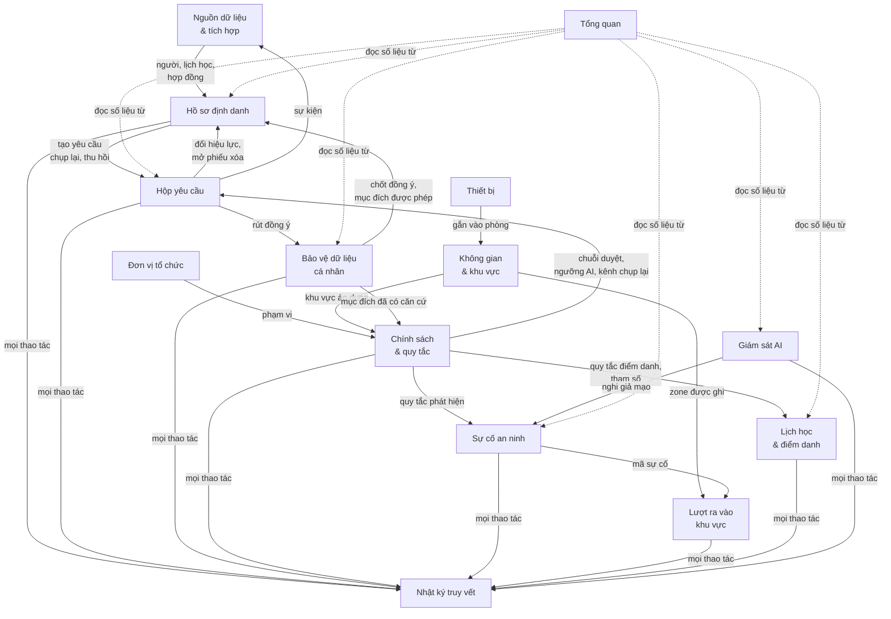

### 9.2. Bảng liên kết điều hướng

| Từ màn hình | Đến màn hình | Khi nào |
|---|---|---|
| Tổng quan | Hồ sơ (nhóm Chưa thu thập) | Bấm chỉ số Tỷ lệ phủ |
| Tổng quan | Hộp yêu cầu (lọc theo loại) | Bấm chỉ số chụp lại, ô hàng chờ |
| Tổng quan | Sự cố an ninh, Giám sát AI, Lịch học, Tích hợp, Thiết bị | Bấm từng dòng "Cần xử lý", "Cảnh báo bất thường" |
| Hồ sơ | Hộp yêu cầu | Mở yêu cầu liên quan; nút "Duyệt REQ-xxxx" |
| Hồ sơ | Tích hợp | Nút "Nguồn dữ liệu" |
| Hộp yêu cầu | Hồ sơ | Liên kết "Hồ sơ" trong chi tiết |
| Bảo vệ dữ liệu | Hộp yêu cầu | "Xác nhận REQ-xxxx" ở phiếu xóa chờ xác nhận |
| Bảo vệ dữ liệu | Hồ sơ | Bấm tên người cần xử lý |
| Lượt ra vào | Bảo vệ dữ liệu (Mục đích) | Banner cảnh báo chạy bóng |
| Lượt ra vào | Không gian | Bật / tắt ghi theo zone |
| Lịch học (bảng tiết) | Lịch học (Ngoại lệ) | Nhãn "Dạy thay, chưa đăng ký" |
| Giám sát AI | Sự cố an ninh (nhóm Giả mạo) | Chỉ số "Nghi giả mạo đang mở" |
| Thông báo (chuông) | Hộp yêu cầu, Tích hợp, Sự cố an ninh | Bấm thông báo |

### 9.3. Chốt kiểm soát dùng chung

| Chốt | Áp dụng ở |
|---|---|
| Phải có đồng ý hợp lệ | Xem ảnh gốc, chụp lại, kích hoạt, mở khóa, duyệt yêu cầu (trừ thu hồi, rút đồng ý), nhắc thu thập |
| Phải nêu lý do | Mọi thao tác thay đổi trạng thái, xem dữ liệu nhạy cảm, từ chối, đóng sự cố |
| Hai người khác nhau | Thu hồi Face ID, tra cứu hành trình, bật quy tắc sự kiện |
| Đúng vai trò của bước | Duyệt yêu cầu, xử lý ngoại lệ học vụ, duyệt tra cứu |
| Ghi nhật ký bất biến | Tất cả các thao tác trên |

---

## 10. Các luồng nghiệp vụ chính

### 10.1. Luồng tổng thể của hệ thống

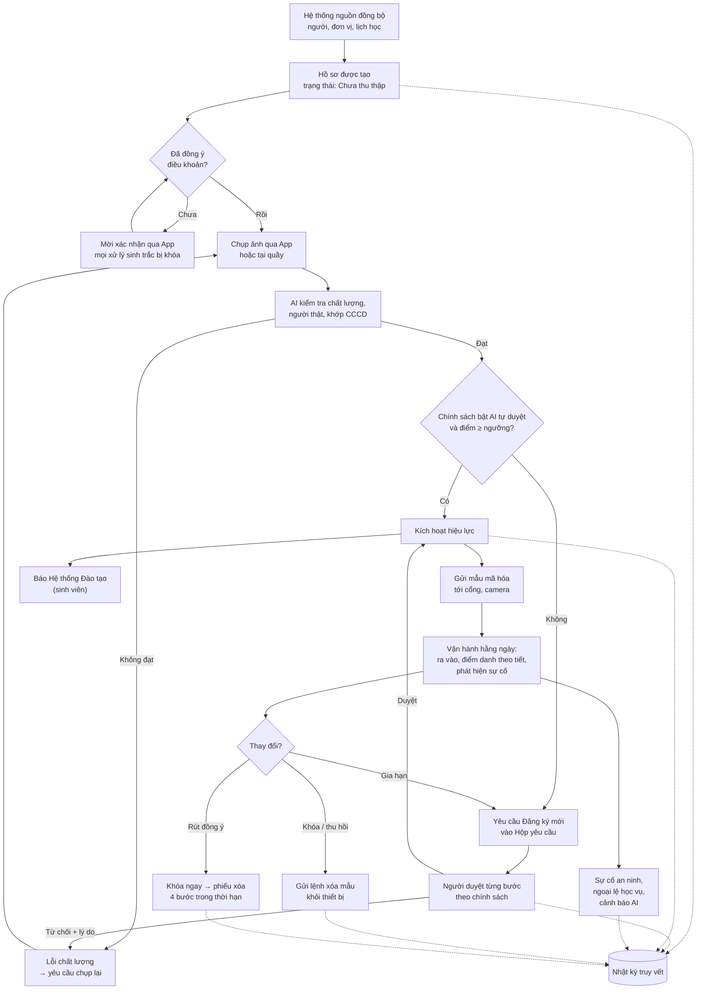

### 10.2. Đăng ký mới và AI tự duyệt

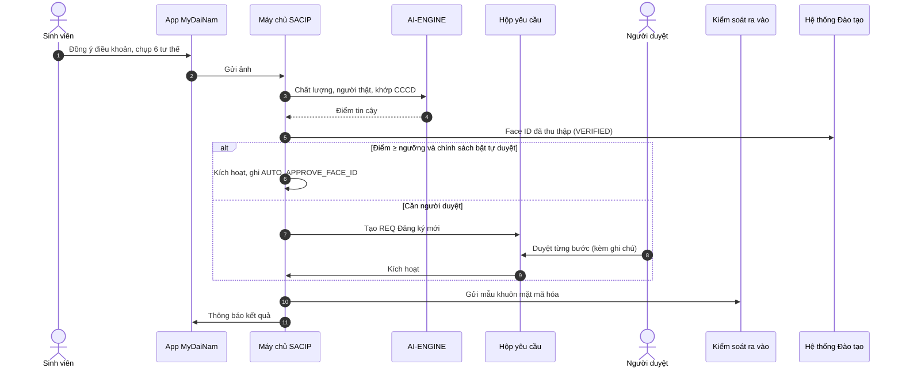

### 10.3. Chụp lại

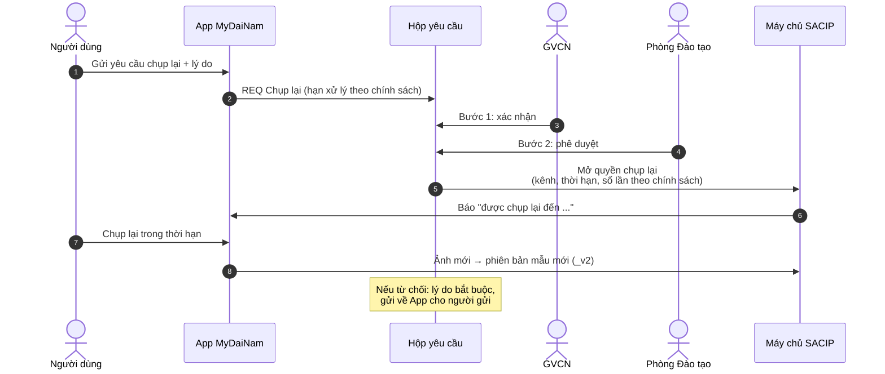

### 10.4. Thu hồi với nguyên tắc hai người

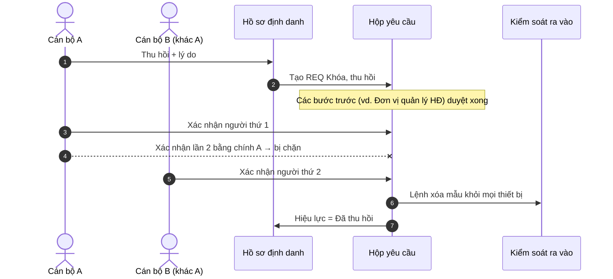

### 10.5. Đồng ý, rút đồng ý và quyền được lãng quên

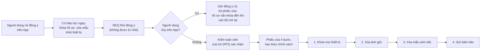

### 10.6. Thay đổi chính sách

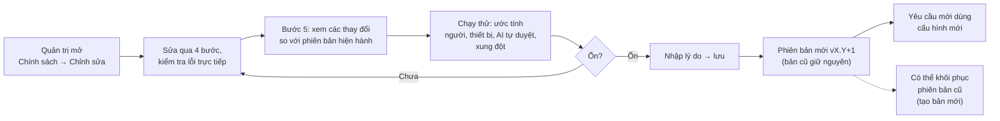

### 10.7. Sự cố an ninh

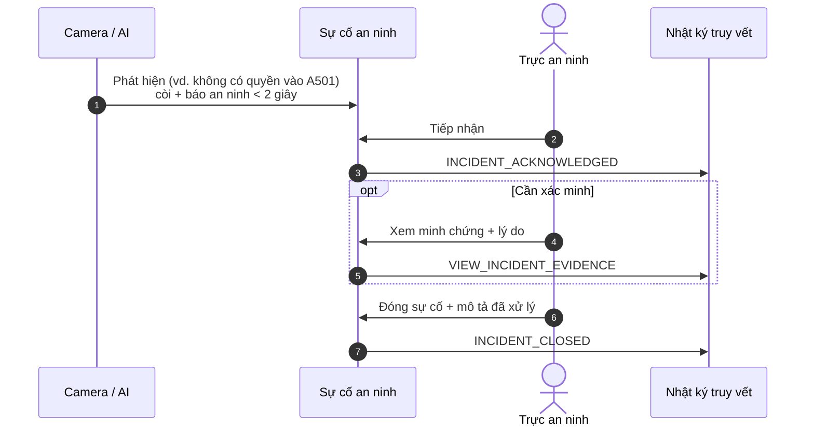

### 10.8. Tra cứu hành trình một người

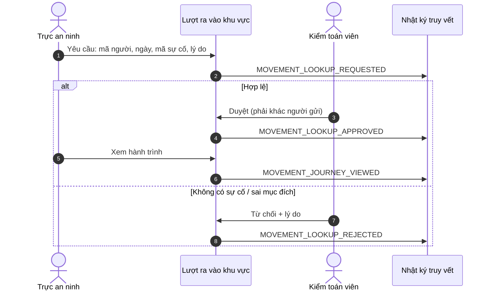

### 10.9. Điểm danh theo tiết và khiếu nại

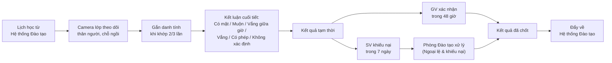

---

## 11. Tuân thủ pháp lý và bảo vệ dữ liệu

### 11.1. Nguyên tắc và cách hệ thống thực hiện

| Nguyên tắc (Luật 91/2025) | Cách Console thực hiện |
|---|---|
| Có sự đồng ý của chủ thể | Chốt đồng ý chặn mọi xử lý sinh trắc; theo dõi phiên bản điều khoản từng người |
| Giới hạn mục đích | 8 mục đích tách riêng; quy tắc chỉ bật thật khi mục đích đã có căn cứ; đồng ý cũ chỉ dùng cho mục đích cũ |
| Tối thiểu hóa dữ liệu | Làm mờ khuôn mặt; khuôn mặt không khớp danh sách lớp bị loại ngay tại thiết bị; không ghi ở khu riêng tư; không dùng thuộc tính nhân khẩu học |
| Giới hạn lưu trữ | Thời hạn lưu cho từng loại dữ liệu; phiếu xóa có hạn |
| Quyền của chủ thể | Rút đồng ý bất kỳ lúc nào, không bị từ chối; quyền được lãng quên 4 bước; người bị tra cứu hành trình được biết |
| Bảo mật | Ảnh gốc qua đường dẫn 60 giây; mẫu khuôn mặt mã hóa AES-256 với khóa xoay vòng hằng tháng; Console không thấy mẫu thô |
| Trách nhiệm giải trình | Nhật ký chuỗi băm, kiểm tra toàn vẹn, xuất kèm mã băm |
| Đánh giá tác động (DPIA) | Theo dõi trạng thái DPIA; danh sách mục đích phải cập nhật DPIA trước khi bật |

### 11.2. Mục đích xử lý

| Mã | Mục đích | Trạng thái |
|---|---|---|
| P-ATT-START | Điểm danh đầu giờ theo lịch học | Đã có căn cứ (v1.2) |
| P-ACCESS | Ra vào cổng, KTX, phòng thí nghiệm | Đã có căn cứ (v1.2) |
| P-DENSITY | Thống kê mật độ ẩn danh | Đã có căn cứ |
| P-SECURITY | An ninh khu vực hạn chế (phát hiện người lạ) | Chờ v1.3 + DPIA |
| P-ATT-CONT | Theo dõi có mặt trong tiết | Chờ v1.3 + DPIA |
| P-LECTURER | Nhận diện giảng viên, thống kê giờ dạy | Chờ v1.3 + nội quy lao động |
| P-RECORD | Ghi hình và phát hành video bài giảng | Chờ v1.3 |
| P-MOVE | Ghi lượt ra vào các zone | Chờ v1.3 + DPIA |

### 11.3. Thời hạn lưu trữ

| Loại dữ liệu | Thời hạn |
|---|---|
| Sự kiện nhận diện thô | Đến hết hạn khiếu nại của học kỳ |
| Kết luận điểm danh theo tiết | Theo quy chế hồ sơ học vụ |
| Minh chứng điểm danh (ảnh làm mờ) | Đến hết hạn khiếu nại của học kỳ |
| Minh chứng sự cố an ninh | 30 ngày; lâu hơn khi đang điều tra |
| Dữ liệu hiện diện GV / CBNV | Xóa khi chấm dứt hợp đồng |
| Lượt ra vào zone | 90 ngày rồi tự xóa |
| Mẫu khuôn mặt (vector) | Xóa sau khi rút đồng ý hoặc thôi học (xem vấn đề mở 12.4) |

### 11.4. Phiên bản điều khoản đồng ý

| Phiên bản | Ban hành | Mục đích | Số người ký |
|---|---|---|---:|
| v1.0 | 01/09/2023 | Điểm danh lớp học, ra vào cổng | 3.424 |
| v1.1 | 15/02/2024 | + Ra vào KTX, phòng thí nghiệm | 610 |
| v1.2 (hiện hành) | 01/08/2025 | + Phát hành thẻ sinh viên; xóa trong 30 ngày sau khi rút | 19.840 |
| v1.3 (dự thảo) | Chưa ban hành | Tách riêng từng mục đích mới | — |

---

## 12. Hiện trạng triển khai, rủi ro và vấn đề mở

### 12.1. Đã hoàn thành

- Giao diện đủ 15 màn hình, thống nhất từ vựng tiếng Việt (bảng từ vựng tại `docs/glossary.md`).
- Toàn bộ quy tắc nghiệp vụ ở mục 8, 9 đã được cài đặt và kiểm thử trên API giả lập: chuỗi duyệt theo vai trò, hai người, chốt đồng ý, thống kê cân đối, nhật ký chuỗi băm.
- Màn hình Hồ sơ định danh đã đọc được dữ liệu thật từ `test-openapi.dainam.edu.vn` (chỉ xem).
- Mỗi màn hình có hướng dẫn nhanh (nút !).

### 12.2. Giới hạn của bản hiện tại

| Giới hạn | Ảnh hưởng | Hướng xử lý |
|---|---|---|
| Dữ liệu giả lập nằm trong bộ nhớ trình duyệt | Tải lại trang là mất mọi thao tác | Xây máy chủ SACIP, thay thân các hàm trong `api/client.js` |
| Chưa có đăng nhập thật | Vai trò chọn tay ở góc màn hình | Tích hợp SSO của trường, phân quyền phía máy chủ |
| Khóa API chỉ an toàn khi chạy thử (proxy máy chủ dev) | Bản đóng gói không gọi được API thật | Cần máy chủ trung gian khi triển khai |
| Một số cấu hình (tham số điểm danh, bật ghi lượt ra vào, quy tắc sự kiện) mới lưu trong phiên | Không chia sẻ giữa người dùng | Chuyển vào API như các phần đã làm |
| Hành trình minh họa chỉ có cho 1 sinh viên mẫu | Trình diễn hạn chế | Nối dữ liệu sự kiện thật |
| Chưa kết nối thật các hệ thống nguồn, Kiểm soát ra vào, Thông báo | Sự kiện mới là mô phỏng | Ký thỏa thuận giao tiếp (API contract) với từng hệ thống |

### 12.3. Rủi ro

| Rủi ro | Mức | Biện pháp |
|---|---|---|
| Xử lý dữ liệu cho mục đích chưa có căn cứ | Cao | Quy tắc chỉ chạy bóng; khóa bật thật đến khi có v1.3, DPIA |
| AI chấm lệch với một nhóm (đeo kính, ánh sáng) | Trung bình | Cảnh báo lệch chuẩn; AI không được tự từ chối |
| Giả mạo khuôn mặt (ảnh in, màn hình), gian lận thiết bị | Trung bình | Kiểm tra người thật; phát hiện bất thường theo thiết bị; sự cố an ninh |
| Cán bộ truy cập dữ liệu vô cớ | Trung bình | Lý do bắt buộc, nhật ký bất biến, chỉ số lượt xem tăng bất thường |
| Đồng ý của người lao động khó coi là tự nguyện | Trung bình | Nội quy lao động, ý kiến công đoàn trước khi bật mục đích liên quan GV/CBNV |
| Mất đồng bộ nguồn (vd. Chấm công mất 26 giờ) | Thấp – trung bình | Cảnh báo trên menu và Tổng quan; chính sách dùng dữ liệu cũ có ghi chú |

### 12.4. Vấn đề mở cần quyết định

| # | Vấn đề | Đề xuất | Cần ai quyết |
|---:|---|---|---|
| 1 | Thời hạn xóa mẫu khuôn mặt: bảng lưu trữ ghi **20 ngày**, điều khoản v1.2 và chính sách ghi **30 ngày** | Thống nhất 30 ngày theo điều khoản đã ký | Pháp chế, cán bộ bảo vệ dữ liệu |
| 2 | Ban hành điều khoản v1.3 tách từng mục đích | Soạn và lấy đồng ý riêng cho từng mục đích mới | Ban Giám hiệu, Pháp chế |
| 3 | Cập nhật DPIA | Lập lại DPIA, mời công đoàn, Hội SV tham gia | Cán bộ bảo vệ dữ liệu |
| 4 | Face ID với GV / CBNV | Đưa vào nội quy lao động, tham khảo công đoàn | Phòng Tổ chức, Công đoàn |
| 5 | Người từ chối Face ID | Hệ thống hướng tới mọi người dùng Face ID; vẫn cần quy trình cho người không đồng ý vì đồng ý phải tự nguyện | Ban Giám hiệu, Pháp chế |
| 6 | Kênh chụp cho nhà thầu, khách | Trạm chụp tại quầy (thiết bị riêng) thay cho màn hình Kiosk trên Console đã gỡ | Phòng CNTT |
| 7 | `README.md` còn mô tả màn hình Kiosk và tên trang cũ | Cập nhật theo tài liệu này | Nhóm phát triển |

---

## 13. Lộ trình đề xuất

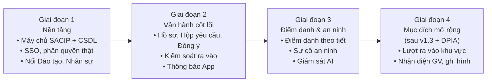

| Giai đoạn | Điều kiện bắt đầu | Kết quả |
|---|---|---|
| 1. Nền tảng | Phê duyệt kiến trúc | Console chạy trên dữ liệu thật, đăng nhập thật |
| 2. Vận hành cốt lõi | Giai đoạn 1 xong | Thu thập, duyệt, kích hoạt Face ID cho sinh viên thật; cổng mở bằng khuôn mặt |
| 3. Điểm danh & an ninh | Hạ tầng camera lớp học, cổng đã duyệt | Điểm danh tự động theo tiết; bàn trực an ninh |
| 4. Mục đích mở rộng | Điều khoản v1.3, DPIA, nội quy lao động | Bật các quy tắc đang chạy bóng |

---

## 14. Phụ lục

### 14.1. Bảng thuật ngữ

| Thuật ngữ | Nghĩa |
|---|---|
| Face ID | Mẫu nhận diện khuôn mặt của một người trong SACIP |
| Hồ sơ định danh | Bản ghi một người (sinh viên, cán bộ…) cùng 5 trạng thái |
| Chính sách sinh trắc | Bộ cấu hình cho một loại đối tượng; có phiên bản |
| Quy tắc sự kiện | Điều kiện phát hiện (vd. vào khu hạn chế) và hành động kèm theo |
| Chạy bóng | Quy tắc chạy để thống kê, so sánh, không phát cảnh báo, không lưu danh tính |
| Chạy thử | Ước tính ảnh hưởng của cấu hình mới trước khi lưu |
| AI tự duyệt | AI kích hoạt Face ID khi điểm tin cậy đạt ngưỡng chính sách |
| Kiểm tra người thật | Phát hiện ảnh in, màn hình đưa trước camera |
| Lệch chuẩn | AI chấm điểm không đều giữa các điều kiện, nhóm |
| Quyền được lãng quên | Quyền yêu cầu xóa dữ liệu sau khi rút đồng ý |
| DPIA | Hồ sơ đánh giá tác động xử lý dữ liệu cá nhân |
| Chuỗi mã băm | Mỗi dòng nhật ký mang dấu vân tay của dòng trước; sửa một dòng là gãy chuỗi |
| Nguyên tắc hai người | Thao tác rủi ro cao cần hai cán bộ khác nhau xác nhận |
| Zone | Khu vực được camera giám sát ranh giới |

### 14.2. Mã hành động trong Nhật ký truy vết (chọn lọc)

| Nhóm | Mã |
|---|---|
| Hồ sơ | `VIEW_ORIGINAL_IMAGE`, `LOCK_PROFILE`, `UNLOCK_PROFILE`, `ACTIVATE_PROFILE`, `SEND_REMINDER`, `RISK_FLAGGED`, `RISK_CLEARED` |
| Yêu cầu | `CREATE_REQUEST`, `APPROVE_STEP`, `APPROVE_REQUEST`, `REJECT_REQUEST`, `REJECT_RESCAN_REQUEST`, `CANCEL_REQUEST`, `REVOKE_FIRST_CONFIRM`, `AUTO_APPROVE_FACE_ID` |
| Đồng ý | `CONSENT_SIGNED`, `CONSENT_RECONFIRM_REQUESTED`, `CONSENT_WITHDRAW_CONFIRMED`, `DATA_ERASED` |
| Chính sách | `POLICY_VERSION_CREATED`, `POLICY_ROLLBACK`, `POLICY_DRY_RUN` |
| An ninh | `INCIDENT_ACKNOWLEDGED`, `INCIDENT_CLOSED`, `VIEW_INCIDENT_EVIDENCE` |
| Lượt ra vào | `MOVEMENT_LOOKUP_REQUESTED`, `MOVEMENT_LOOKUP_APPROVED`, `MOVEMENT_LOOKUP_REJECTED`, `MOVEMENT_JOURNEY_VIEWED` |
| Học vụ | `ATTENDANCE_CASE_DECIDED` |
| AI | `ANOMALY_RESOLVED` |
| Hạ tầng | `SPACE_CREATED`, `SPACE_APPROVED`, `DEVICE_ASSIGNED`, `ORG_UNIT_CREATED`… |
| Nhật ký | `AUDIT_CHAIN_VERIFIED`, `AUDIT_EXPORT_SIGNED` |

### 14.3. Cấu trúc mã nguồn

| Thư mục / tệp | Nội dung |
|---|---|
| `src/main.jsx` | Khai báo 15 route, chặn route theo quyền |
| `src/store.jsx` | Trạng thái toàn ứng dụng, vai trò, hàm `call()` |
| `src/components/Layout.jsx` | Menu, thanh trên, thông báo |
| `src/components/ui.jsx` | Thành phần dùng chung, `PageHeader` có nút hướng dẫn |
| `src/pages/*.jsx` | Từng màn hình |
| `src/api/client.js` | API giả lập: toàn bộ quy tắc nghiệp vụ, nhật ký |
| `src/api/db.js` | Dữ liệu khởi tạo phía "máy chủ" |
| `src/api/enums.js` | Trạng thái, vai trò, quyền duyệt từng bước, mã hành động |
| `src/api/policyValidation.js` | Kiểm tra cấu hình chính sách |
| `src/api/faceDocuments.js` | Đọc hồ sơ thật từ API trường |
| `src/data/*.js` | Dữ liệu mẫu: điểm danh, lượt ra vào, thiết bị, không gian |
| `src/lib/pageHelp.js` | Nội dung hướng dẫn nhanh từng màn hình |
| `docs/glossary.md` | Bảng từ vựng giao diện |
